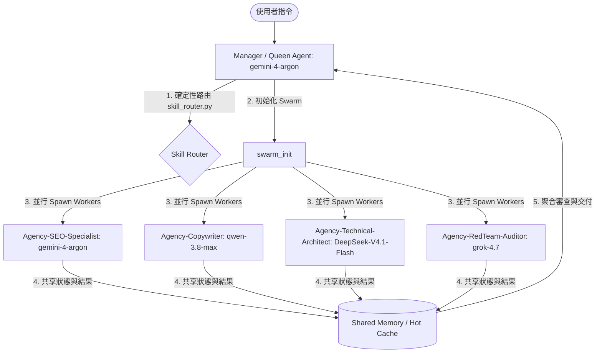

// turbo-all

# iMCheck Swarm 技能協同啟動工作流 (Swarm Skill Orchestrator)

本工作流專為 **iMCheck 全系列 (iPhone/iPad/MacBook/Windows)「檢測回收與估價」** 設計。旨在讓 AI 在面對使用者下達的任何指令時，能夠**動態分析任務維度**，自動調度並掛載當前 **28 個 Active Domain Skills (Hot Library)**，並以 **Ruflo Swarm V3** 多代理並行協作的方式，實現最高品質的專案交付。

---

## 1. 任務特徵分析與路由 (Task Context & Skill Routing)

當收到任何使用者指令時，主代理 (Manager) 必須依照以下兩個維度進行特徵解析（或直接執行 `python C:\Users\Jiaxing\.gemini\scripts\skill_router.py route "<指令>"` 取得確定性 Top-5 技能推薦）：

### A. 產品平台與業務維度 (Platform & Business Scope)
* **硬體平台**：`iPhone` | `iPad` | `MacBook` | `Windows (PC/Laptop)`
* **業務核心**：`AI 檢測 (Inspection)` | `二手回收 (Recycling)` | `線上估價 (Valuation)` | `實體通路 (Kiosk/Locations)` | `軍規抹除 (Securaze)`

### B. 技能路由對照表 (28 Active Domain Skills Mapping)

| 任務範疇 | 核心 Hot Skills (Active Triggers) | Swarm 協調重點 |
| :--- | :--- | :--- |
| **競品與關鍵字研究** | `competitor-analysis` + `keyword-research` + `content-gap-analysis` | 掃描 Apple / Windows 二手回收市場報價與關鍵字缺口。 |
| **EEAT 內容與文案** | `seo-content-writer` + `content-quality-auditor` + `content-refresher` + `meta-tags-optimizer` | 撰寫極具共情力的台式回收文案，執行 80 項 EEAT 評分。 |
| **GEO / AEO 與實體** | `geo-content-optimizer` + `entity-optimizer` + `schema-markup-generator` | 優化 ChatGPT/Perplexity AI 搜尋引用，生成店面 Schema。 |
| **技術與內鏈優化** | `technical-seo-checker` + `on-page-seo-auditor` + `internal-linking-optimizer` | 診斷網頁效能，布建全站回收關鍵字內鏈，防死鍊。 |
| **監控、預警與反向鏈** | `rank-tracker` + `alert-manager` + `serp-analysis` + `backlink-analyzer` | 監控全平台機型回收價格之 SERP 排名變動與外鏈權重。 |
| **記憶與狀態治理** | `memory-management` | 維護 HOT/WARM/COLD 三階記憶，防止跨會話失憶。 |

---

## 2. Swarm 多代理協作架構 (Ruflo Swarm V3 Architecture)



---

## 3. Swarm 啟動與執行規範 (Ruflo Swarm V3 Commands)

### 步驟 1：初始化 Swarm 會話
```bash
npx ruflo@latest swarm init --topology hierarchical-mesh --max-agents 6 --strategy specialized
```

### 步驟 2：派發專業領域 Worker (Spawn Agents — Ruflo Swarm V3 模型矩陣)
```bash
# 啟動 SEO 策略專家 (掛載競品與關鍵字技能 — 採用百萬 Context 多模態旗艦 gemini-4-argon)
npx ruflo@latest agent spawn -t analyst --name Agency-SEO-Specialist --model gemini-4-argon -p "目標：分析 [機型/平台] 的二手回收市場缺口並提取長尾詞。"

# 啟動 EEAT 文案創作師 (掛載文案與審計技能 — 採用繁體中文與結構化王者 qwen-3.8-max)
npx ruflo@latest agent spawn -t coder --name Agency-Copywriter --model qwen-3.8-max -p "目標：依據 SEO 詞庫，撰寫台灣共情文案，並執行 EEAT 品質審查。"

# 啟動 技術架構師 (掛載診斷與內鏈技能 — 採用極速推理與語法掃描 DeepSeek-V4.1-Flash)
npx ruflo@latest agent spawn -t coder --name Agency-Technical-Architect --model DeepSeek-V4.1-Flash -p "目標：診斷 [網頁路徑] 的 on-page 結構，並布建內部回收連結。"

# 啟動 紅隊品質審計員 (掛載反 AI 痕跡與對抗審查 — 採用零盲從紅隊模型 grok-4.7)
npx ruflo@latest agent spawn -t reviewer --name Agency-RedTeam-Auditor --model grok-4.7 -p "目標：針對產出文案與 Schema 進行對抗性紅隊審查，揪出 AI 機械感與合規漏洞。"
```

### 步驟 3：記憶同步與狀態落盤
- `memory/hot-cache.md` (最核心的 80 行熱資料，在 SessionStart 自動加載)
- `memory/decisions.md` (記錄所有經 User 同意的架構決策)

---

## 4. 品質門禁檢查 (Quality Gatekeeping)

- [ ] **多平台覆蓋性**：該優化是否完美適配 iPhone/iPad/MacBook/Windows 各平台？
- [ ] **EEAT 品質驗證**：產出的文案是否通過了 `content-quality-auditor` 的 E-E-A-T 80 項核心審查？
- [ ] **GTM 與內鏈完整性**：GTM 追蹤碼是否布建正確，且 `internal-linking-optimizer` 掃描無死連結？
- [ ] **防越界安全 (Boundary Sentinel)**：確認所有變更均鎖定在當前專案工作區，無越界操作。

---

## 5. 異常處理與死局逃脫 (Loop Engineering & Fallback Routing)

- **邊界限制 (Bounded Loops)**：所有被派發的 Worker Agent 在單一任務的自我修復或測試循環中，**上限皆為 5 次**。內部品質 Review 退回上限為 **3 次**。
- **觸發 Fixer (Agent D — `qwen-3.8-max` 重裝救援)**：若某個 Worker 無法通過「品質門禁檢查」且退回重修超過 3 次；或在測試/執行層面發生連續 2 次相同錯誤，Manager 必須立刻中止該 Worker，並動態調度 `fixer-prompt.md` 啟動專門的除錯代理（強制升級為 **`qwen-3.8-max`**，由 `DeepSeek-V4.1-Flash` 先行定位行號）：
  ```bash
  npx ruflo@latest agent spawn -t fixer --name Agency-Fixer --model qwen-3.8-max -p "目標：讀取失敗日誌與關聯檔案，指出根本原因並精準修復，不准盲猜或作弊。"
  ```
- **防作弊機制監督**：Manager 必須確保所有 Worker 沒有為了通過門禁而使用 `@skip`、刪除斷言或弱化檢查條件。
- **知識沉澱與全局共享 (Self-Improvement)**：若 Fixer 成功解決問題並產出 `<PatternExtract>`，Manager 必須調用 `npx ruflo@latest memory pattern-store --global --add` 將其存入全域資料庫。