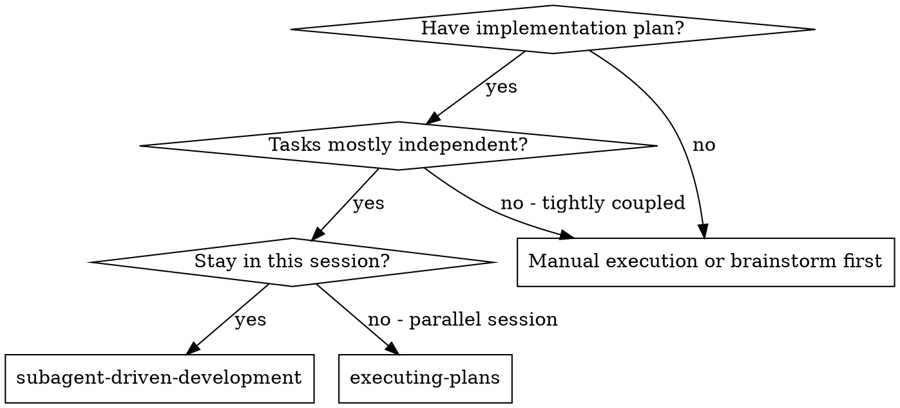
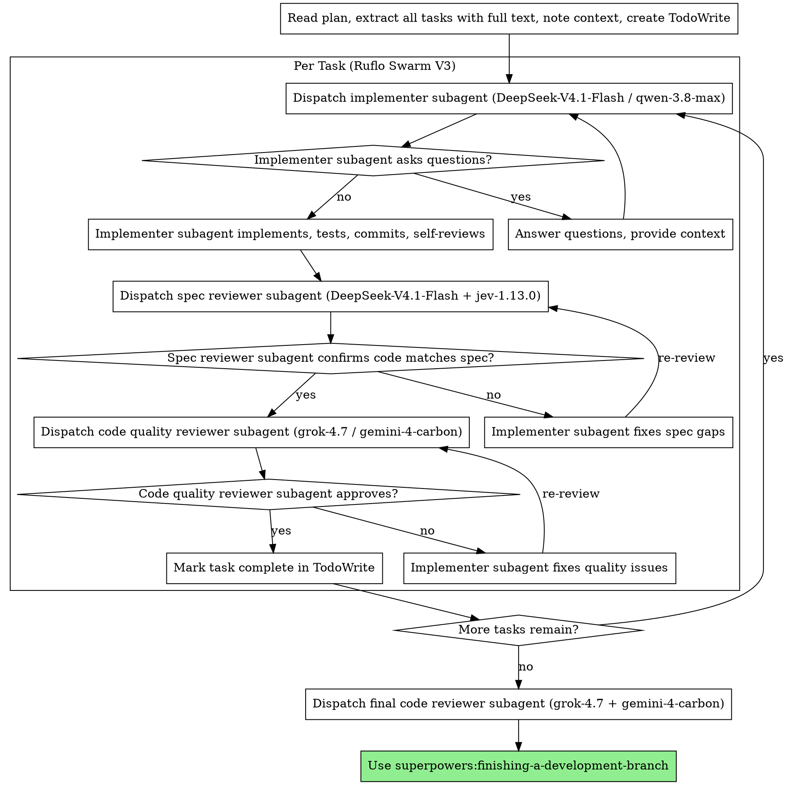

# Subagent-Driven Development (Ruflo Swarm V3)

Execute plan by dispatching fresh subagent per task, with two-stage review after each: spec compliance review first, then adversarial code quality review.

**Core principle:** Fresh subagent per task + Asymmetric two-stage review (spec then quality) = high quality, fast iteration, and maximum cost-efficiency via **Ruflo Swarm V3** orthogonal model routing.

## When to Use

## The Process

## Prompt Templates & Ruflo Swarm V3 Model Routing

To execute these phases and eliminate same-model blind spots, use explicit orthogonal model delegation:

- `./implementer-prompt.md` - Dispatch implementer subagent (`🛠️ Agent D`)
  - **Command**: `npx ruflo@latest agent spawn -t coder --model DeepSeek-V4.1-Flash` (or `--model qwen-3.8-max` for multi-file refactors & complex React/TS)
  - **Why**: `DeepSeek-V4.1-Flash` delivers ultra-fast, high-precision coding for scoped tasks; `qwen-3.8-max` handles heavy structural refactoring.
- `./spec-reviewer-prompt.md` - Dispatch spec compliance reviewer subagent (`🔍 Agent E-Spec`)
  - **Command**: `npx ruflo@latest agent spawn -t reviewer --model DeepSeek-V4.1-Flash` (with TypeSafe `jev-1.13.0` calibrated scoring)
  - **Why**: Spec compliance is a fast deterministic checklist task where `DeepSeek-V4.1-Flash` + `jev-1.13.0` verify 100% requirement coverage at sub-second latency.
- `./code-quality-reviewer-prompt.md` - Dispatch adversarial code quality reviewer subagent (`😈 Agent B / E-Quality`)
  - **Command**: `npx ruflo@latest agent spawn -t qa --model grok-4.7` (or `--model gemini-4-carbon` for visual/multimodal UI review)
  - **Why**: `grok-4.7` provides zero-sycophancy adversarial code review from an orthogonal model family, catching edge cases that the implementer missed; `gemini-4-carbon` audits multimodal UI/UX.
- `./fixer-prompt.md` - Dispatch dead-end Fixer subagent (`🛠️ Agent D-Fixer`)
  - **Command**: `npx ruflo@latest agent spawn -t fixer --model qwen-3.8-max`
  - **Why**: When tests or reviews fail repeatedly (>= 2 identical errors or > 3 review rejections), a fresh zero-context `qwen-3.8-max` Fixer surgically diagnoses root causes from first principles.

## Red Flags & Bounded Loops

- **Never** start code quality review (`grok-4.7`) before spec compliance (`DeepSeek-V4.1-Flash`) is ✅.
- **Never** hand off to Spec Reviewer without running dynamic execution validation (`pytest`, `npx tsc --noEmit`, `curl`) first.
- **Bounded Loop Limit**: Maximum **3 review loops** per task or **2 identical test failures**. Upon hitting the limit, immediately escalate to **`qwen-3.8-max` Fixer Subagent** (`fixer-prompt`).
- **Self-Improvement**: After Fixer succeeds and returns `<PatternExtract>`, persist it to `~/.gemini/memory/` or `npx ruflo@latest memory pattern-store --add`.

## ⚠️ Gotchas (避坑指南)
- **禁止同源模型自審**：Implementer 與 Code Quality Reviewer 必須保持模型正交（例如 `DeepSeek-V4.1-Flash` / `qwen-3.8-max` 實作，交由 `grok-4.7` 進行紅隊品質審查）。
- **終端機輸出保護 (Context Overflow Prevention)**：子代理執行測試或 API 驗證時，禁止將巨量 JSON 直接印到 stdout，請導向暫存檔或加上 `-q` 參數。
