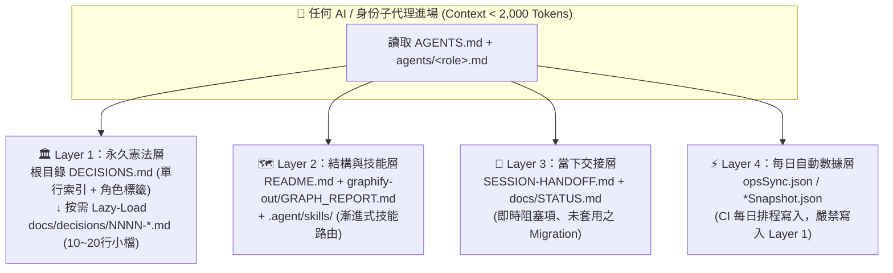

# 跨 AI 系統、多代理工作室與漸進式決策治理公版規範 V2.0
## (`graphify` + `README.md` + `DECISIONS.md` + `Identity Agent Studio` + `Governance-as-Code`)

> [!IMPORTANT]
> **文件定位**：本文件為通用公版架構規範（Blueprint Template），適用於任何導入 **多 AI 工具協作**（Antigravity、Cursor、Claude Code、Codex、Grok、Gemini CLI）、**多角色身份 Agent 工作室（Role-Based Agent Studio）**、**領域技能庫（Agent Skills）** 與 **每日動態數據同步** 的軟體工程專案。
> **核心目標**：以 **零額外雲端成本、零廠商鎖定、極低 Context Token 消耗（進場 `< 2,000 Tokens`）** 的方式，讓任何 AI 或子代理進場時都能秒懂「系統結構是什麼（What & How）」、「哪些紅線絕對不能踩（Why）」與「當下進度在哪裡（Now）」。

---

## 1. 核心痛點與第一性原理剖析 (Why This Architecture?)

在跨 AI 客戶端與多代理（Multi-Agent Swarm）平行開發的中大型專案中，工程團隊普遍面臨 **五大失憶與腐敗災難**：

1. **只看程式碼看不出「為什麼（Why）」**：
   - AST 與知識圖譜（如 `graphify`）能告訴 AI「現在有哪些函式與依賴（What & How）」，但無法告訴 AI「為什麼預覽站連正式庫卻嚴禁寫入」、「為什麼圖檔強制走 R2 代理而不走預設 Storage」、「為什麼某 API 絕對不能在非正式環境呼叫」。沒記錄下來，下一個進場的 AI 就會「好心重構」而捅出生產事故。
2. **傳統單一 `DECISIONS.md` 流水帳的 Context 爆炸與規則混淆**：
   - 若把每次決策的長篇背景都往同一個 `DECISIONS.md` 塞，半年後會膨脹為上千行流水帳：不僅每次讀取白白消耗數萬 Tokens，更糟的是 AI 會把「半年前早已作廢的舊決定」誤當成現行規則遵守。
3. **多角色 Agent 進場的「全讀太貴、不讀踩雷」兩難**：
   - 當專案設有 PM、Architect、Backend/DB、Frontend、Migration、QA 等角色 Agent 時，若每個子代理都全讀所有架構文件會瞬間撐爆 Context Window；若只讀自己的一小塊，又會漏掉跨領域紅線（例如 DB Agent 不知道圖檔已改走 R2，還在建 Storage Bucket）。
4. **靜態長期決策與動態每日數據的「時間軸精神分裂」**：
   - 專案同時有「跨年不變的架構紅線」、「跨 Session 的當日交接（Handoff）」與「每日 CI/CD 自動更新的業務快照（如 `opsSync.json`）」。若沒有明確分層，AI 極易把單日動態數字（如「10/14 共 1,051 筆」）寫死進長期架構文件，隔天自動同步後立刻變成過期假資訊（Data Poisoning）。
5. **純靠 Markdown 規範缺乏「自動化門禁（Governance-as-Code）」**：
   - 只寫規則卻沒有測試把關，2 週後就會出現斷鏈、孤兒檔、超過百行的臃腫小檔，或目錄表標為「已取代」但內文仍寫「有效」的雙向分裂。

---

## 2. 核心架構：四層記憶時間軸 × 三層漸進式揭露

### 2.1 四層記憶時間軸契約 (Four-Tier Memory Timeline)

我們將專案內的所有知識與狀態，依「變更頻率（Half-Life）」嚴格拆分為四個正交層級，嚴禁跨層混寫：



| 記憶層級 | 存放位置 | 變更頻率 | 核心職責與紅線 | AI 載入策略 |
| :--- | :--- | :---: | :--- | :--- |
| **Layer 1：永久憲法層** | `/DECISIONS.md` + `/docs/decisions/NNNN-*.md` | 月 ～ 年 | 記錄不可逆架構選擇與生產紅線（Why）。**嚴禁寫入單日動態數據**。 | 進場必讀 `/DECISIONS.md` 目錄表；僅開啟符合自身「角色標籤」且狀態為 **`有效`** 之小檔。 |
| **Layer 2：結構與技能層** | `/README.md` + `/graphify-out/` + `/.agent/skills/` | 週 ～ 月 | 記錄系統拓撲（What & How）與領域標準技能（Skills）。**未授權禁跑 `graphify update` 覆蓋大圖**。 | 進場讀 `README.md`；探索未知模組先查 `graphify`；觸發關鍵字時按需載入 `SKILL.md`。 |
| **Layer 3：當下交接層** | `/SESSION-HANDOFF.md` + `/docs/STATUS.md` | 日 ～ 每次 Session | 記錄當前分支、尚未套用至正式庫的 SQL Migration、即時阻塞項與下一步。 | 每次跨 AI 接班必讀頂部最新區塊，收工前強制更新。 |
| **Layer 4：每日數據層** | `opsSync.json` / 各類業務快照 JSON | 每日自動（Cron） | 由 GitHub Actions 每日拉取真實匯出檔生成。**檔名對不上即報錯，絕不退回舊檔或補 0**。 | 程式與測試執行期讀取；嚴禁手動捏造數字。 |

---

## 3. 漸進式決策治理「四大防臃腫鐵律」 (Four Anti-Bloat Rules)

### 鐵律一：目錄與內文分離（一個決策一個 10～20 行小檔）
- 根目錄 `DECISIONS.md` **只當單行索引目錄**，絕不寫長篇解釋。
- 每個決策單獨存為 `docs/decisions/NNNN-kebab-slug.md`，**嚴格控制在 10～20 行內（硬上限 $\le 25$ 行）**，固定只寫三段：`## 背景`、`## 決定`、`## 理由`。

### 鐵律二：角色與領域標籤路由（Role-Tagged Lazy Loading）
- `DECISIONS.md` 索引表必須包含 **`適用角色 / 模組`** 欄位（如 `All`、`Supabase / QA`、`Frontend / Warehouse`）。
- 當 PM 派工給「前端工程師 Agent」時，該子代理只需掃描 `DECISIONS.md` 並打開標有 `All` 或 `Frontend` 的有效小檔，**將進場總 Context 壓縮在 `~1,850 Tokens` 以內**，同時達成 100% 紅線命中率。

### 鐵律三：高訊噪比過濾（只記「光看 Code 看不出原因」的決定）
- **✅ 必須寫入**：跨系統資料庫邊界、禁止寫入原則、特殊硬體/Port 禁令、零偽造數據鐵律、正式環境 API 呼叫門禁。
- **❌ 禁止寫入**：日常 UI 微調、一般 Bug 修復、變數改名、每日變動的業務統計數字（這些留在 Git Commit 與 PR 即可）。

### 鐵律四：作廢不刪檔、雙向狀態鎖定（Supersede Without Deleting）
- 當新決策 `0012` 推翻舊決策 `0004` 時：**不刪除舊檔**，而是將 `DECISIONS.md` 目錄表與 `0004` 檔頭的 `- **狀態**` **雙向同步更新**為 `被 0012 取代`。
- AI 進場掃描時**只遵守狀態為「有效」的條目**，自動跳過已取代條目，確保有效規則永遠保持在精簡的 10～25 條內。

---

## 4. 身份 Agent 工作室 × 技能庫 × 決策路由聯動矩陣

在具備多角色分工的專案中，於 `docs/04-多Agent協作計劃.md`（或 `AGENTS.md`）建立以下 **三維聯動表**，並寫入派工模板：

| 身份 Agent (`agents/*.md`) | 負責路徑所有權 (Ownership) | 進場必讀 `DECISIONS.md` 標籤 | 推薦掛載 Skills (`.agent/skills/`) | 交付前強制門禁 (Quality Gate) |
| :--- | :--- | :--- | :--- | :--- |
| **PM / 總協調** | `DECISIONS.md`、`docs/STATUS.md`、`SESSION-HANDOFF.md` | `All`, `PM` | `decisions-governance`, `session-handoff`, `agent-planner`, `skillorchestrator` | 核對任務卡依賴與 `decisions-governance` 測試 |
| **架構師 (Architect)** | `src/lib/**`、`docs/CONVENTIONS.md`、建置設定 | `All`, `Architect` | `decisions-governance`, `graphify`, `agency-engineering-backend-architect` | `npx tsc -b` + 查閱 `graphify-out/GRAPH_REPORT.md` |
| **後端 / DB 工程師** | `supabase/**`（或 `backend/**`） | `All`, `Supabase`, `DB` | `security-audit`, `accidental-data-loss-prevention`, `agency-engineering-database-optimizer` | RLS 匿名零讀取測試 + 雲端圖床/金鑰邊界自檢 |
| **前端工程師** | `src/features/**`、`src/components/**`、`src/app/**` | `All`, `Frontend` | `agency-engineering-frontend-developer`, `react-best-practices`, `d3-data-visualization` | 零偽造數據（`null` $\rightarrow$ `—`，禁 `\|\| 0`）+ 393px 不裁切 |
| **資料遷移 / ETL 工程師** | `scripts/**` | `All`, `Migration` | `migration-refactoring`, `accidental-data-loss-prevention` | 跨表快照筆數與金額 100% 對位驗證 |
| **QA 驗收工程師** | `tests/**`、`docs/acceptance/**` | **`All` + 全數有效條目** | `tdd-workflow`, `verification-quality`, `github-code-review`, `webapp-testing` | 執行全套 Vitest 門禁 + Pre-mortem 逆向驗屍分析 |

---

## 5. 開箱即用公版範本 (Copy-Paste Templates)

### 5.1 `README.md` 頂部導覽提示
```markdown
> **🧭 架構圖譜與決策記憶**：修改核心邏輯、執行跨 AI 更新或啟動身份 Agent 工作室前，請先查閱 [`DECISIONS.md`](DECISIONS.md)（只遵守「有效」條目，按需打開 `docs/decisions/NNNN-*.md`）與 [`graphify-out/GRAPH_REPORT.md`](graphify-out/GRAPH_REPORT.md)。
```

### 5.2 根目錄 `DECISIONS.md` 公版範本
```markdown
# <專案名稱> 架構與重要決策目錄 (DECISIONS)

> **AI 與身份 Agent 必讀規則（四層記憶與漸進式決策載入）**：
> 1. **四層記憶分工**：
>    - **永久憲法層（本檔 [`DECISIONS.md`](DECISIONS.md) + `docs/decisions/`）**：跨月/跨年不可逆架構紅線。AI 進場先讀本表，**只遵守狀態為「有效」的決定**，並依「適用角色」按需打開 `docs/decisions/NNNN-*.md`（每份 10～20 行）。
>    - **結構圖譜層（[`README.md`](README.md) + [`graphify-out/GRAPH_REPORT.md`](graphify-out/GRAPH_REPORT.md)）**：系統模組拓撲（未授權禁止執行 `graphify update` 覆蓋已整理之大圖）。
>    - **當下交接層（[`SESSION-HANDOFF.md`](SESSION-HANDOFF.md) + [`docs/STATUS.md`](docs/STATUS.md)）**：跨 AI Session 即時阻塞項、未套用之 migration 與 Phase 進度。
>    - **每日自動數據層（`opsSync.json` / `*Snapshot.json`）**：由 CI 排程自動更新，嚴禁將單日動態數字寫死於本決策目錄。
> 2. **作廢不刪檔**：若舊決定被推翻，新增一份新編號決策檔，並將本表與舊檔內的狀態同步改為 `被 NNNN 取代`。
> 3. **新增範本**：請複製 [`docs/decisions/0000-template.md`](docs/decisions/0000-template.md)。

| 編號 | 決策摘要（點擊按需讀取） | 狀態 | 日期 | 適用角色 / 模組 |
| :--- | :--- | :---: | :---: | :--- |
| `0001` | [採用 graphify + README + DECISIONS.md 漸進式架構記憶](docs/decisions/0001-graphify-readme-and-decisions-index.md) | **有效** | 2026-10-22 | `All (6 Roles)` · 跨 AI 記憶 |
| `0002` | [範例：沿用既有實況資料庫契約與未授權禁跑線上遷移](docs/decisions/0002-reuse-existing-db-contract.md) | **有效** | 2026-10-22 | `Supabase / Migration / PM` · DB |
| `0003` | [範例：儀表板零偽造數據鐵律與每日快照同步契約](docs/decisions/0003-zero-fabrication-and-daily-sync.md) | **有效** | 2026-10-22 | `Frontend / QA` · 儀表板與報表 |
```

### 5.3 `docs/decisions/0000-template.md` 單一決策小檔範本（嚴格 10～20 行）
```markdown
# NNNN - 決策標題（簡短說明做什麼決定）

- **狀態**：有效（或：被 00XX 取代）
- **日期**：YYYY-MM-DD

## 背景
簡述當時面臨的問題、系統限制或上下文（2～4 行）。

## 決定
明確寫出採用的規則或禁止事項（2～4 行）。

## 理由
說明為什麼這樣選、若違反會造成什麼後果（光看程式碼看不出的原因，2～4 行）。
```

---

## 6. Governance-as-Code：雙軌自動化門禁（Vitest + Python 巡檢）

為徹底解決「寫了文件卻沒人遵守」的腐敗問題，本架構強制配置 **雙軌自動化門禁**：

### 6.1 前端 / CI 原生單元測試門禁 (`tests/decisions-governance.test.ts`)
每次執行 `npm test` 時，在 **10 毫秒內** 自動執行以下 6 項確定性斷言：
1. **雙向連結完整性**：`DECISIONS.md` 表格中的每一條 `docs/decisions/NNNN-*.md` 必須實際存在（無斷鏈），且 `docs/decisions/` 下除 `0000-template.md` 外不得有未登記之孤兒檔。
2. **單檔行數硬上限**：每份 `docs/decisions/NNNN-*.md` 行數強制 $\le 25$ 行，且必備 `## 背景`、`## 決定`、`## 理由` 三節。
3. **有效決策總量門檻**：狀態為 `有效` 的條目數強制 $\le 25$ 條，超標即強制要求合併或淘汰。
4. **狀態雙向一致性**：目錄表中的狀態（`有效` vs `被 NNNN 取代`）必須與小檔內部的 `- **狀態**：...` 100% 吻合。
5. **防動態資料毒化**：正規表達式攔截任何將單日匯出 CSV 檔名或臨時時間戳寫入永久決策檔的行為。
6. **身份 Agent 掛載檢查**：強制驗證所有 `agents/*.md`、`docs/04-多Agent協作計劃.md`、`README.md` 與 `AGENTS.md` 均包含 `DECISIONS.md` 入口引用。

### 6.2 跨專案 Python 巡檢腳本 (`audit_decisions.py`)
支援 Windows 本機（強制 `sys.stdout.reconfigure(encoding="utf-8")` 消除 CP950 亂碼）與 Linux Cloud Agent（自動以 `Path(__file__).resolve().parents[3]` 相對路徑保底，防止假陽性綠燈），並自動掃描內文中的 **`YYYY-MM-DD 複查`** 標記，一旦到期（`due_date <= today`）立即將 `all_healthy` 轉為 `false` 並列入 `overdue_reviews` 告警。

---

## 7. 🤖 供 Grok Bots 群辯論與壓力測試的 5 大核心議題 (Prompts for Bot Swarm)

> **給 Grok Bots 審核群的指令**：
> 請以「多代理系統架構師」、「紅隊資安審計員」與「Developer Experience (DX) 專家」的多重批判視角，針對上述 **《漸進式決策治理公版規範 V2.0》** 進行正交辯論，並回答以下 5 個問題：

1. **【規模擴展性 (Scalability Ceiling)】**：
   當專案演進 2 年後，若「同時有效」的核心架構決策確實超過 25 條（例如成長到 40 條），單張 `DECISIONS.md` 索引表加上 `適用角色 / 模組` 欄位是否仍足夠高效？還是應該在超過 25 條時引入「依領域分組的子表格（Domain Sections）」？
2. **【多代理併發衝突 (Multi-Agent Merge Conflicts)】**：
   當兩個平行的 Worktree 子代理（例如 `Supabase Agent` 與 `Frontend Agent`）同時在同一輪 Sprint 中各自新增一條決策時，兩者都搶號 `0012` 並在 `DECISIONS.md` 最後一行插入，會產生 Git Merge Conflict。改成「編號 + 短領域碼」或「由 PM / Architect 集中領號寫入」哪種在 Swarm 實戰中摩擦最小？
3. **【語意觸發精準度 (Semantic Triggering vs. Rule Enforcement)】**：
   AI Agent 讀取 `DECISIONS.md` 的單行摘要與 `適用角色` 標籤時，有沒有可能「看過摘要覺得跟當前修改無關」而漏開小檔？除了在單行摘要寫清楚「觸發路徑／禁止動詞」外，是否建議在 `DECISIONS.md` 表格把「受保護的檔案路徑 Glob（如 `supabase/**`, `src/features/machines/**`）」顯式列出來？
4. **【四層記憶的邊界清晰度 (Four-Tier Memory Boundary)】**：
   將專案記憶切分為 `DECISIONS.md`（永久憲法）、`graphify + README`（結構圖譜）、`SESSION-HANDOFF.md`（當下交接）、`opsSync.json`（每日自動數據）四層，在跨 AI 客戶端（Cursor $\leftrightarrow$ Antigravity $\leftrightarrow$ Claude Code）切換時，是否存在任何模糊地帶？
5. **【零成本純檔治理 vs. 外部向量記憶庫 (File-Native vs. Vector Memory)】**：
   相較於需要額外維護 MCP Server / 向量資料庫的外部記憶工具，這套「純 Markdown + 漸進式小檔 + Vitest 確定性門禁 + Graphify 圖譜」的做法還缺少什麼能力？有哪些高價值改進可以在不增加外部依賴的前提下補上？
