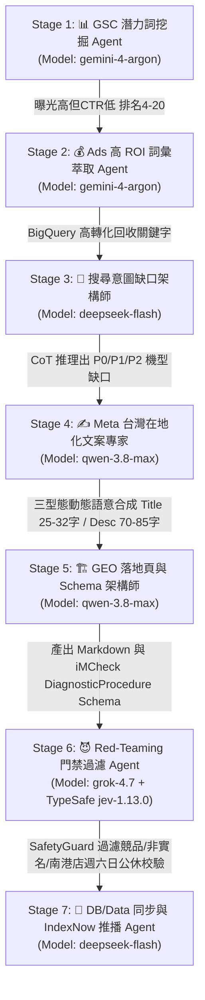

# US3C 二手 3C 回收 3D SEO 防禦飛輪 (Ruflo Swarm V3 Multi-Agent Pipeline)

當使用者下達 `/us3c-seo-loop` 指令時，請嚴格按照 **Ruflo Swarm V3 7 階段模型分流矩陣** 自動切換與調度專業 Agent 執行 US3C 專屬的 SEO 飛輪。

> [!IMPORTANT]
> **🚫 嚴禁硬編碼樣板+變數 (No Template + Variable Concatenation)**
> 本技能導入 **【三大頁面型態權責劃分】x【三層產品架構】x【雙核心關鍵字高權重佈局】**。
> 1. **「手機回收」戰略佈局**：在【門市據點頁】與【手機型號價格頁】高頻自然融入，大幅提升二手手機回收大詞權重。
> 2. **「手機回收機」戰略佈局**：在【全台 24H AI 自助機頁】極致提升，強化 24H 自助手機回收機、手機回收機快存櫃極速撥款。
> 3. **移除 Meta Description 中的營業時間贅字**，100% 釋放寶貴字數給痛點解法與現場撥款高 CTR 誘因。
> 4. 精確保留賣家關心的 **容量 (512GB/1TB)**、**規格 (M3 Max/RAM)** 與 **硬體指標 (電池/快門數)**。

---

## 7 階段 Ruflo Swarm V3 執行架構



---

## 🎯 US3C 家族三站核心關鍵字 (Target Core Keywords) 戰略分工

1. **iMCheck 官網 (`imcheck.com.tw`)** *(全台線上手機回收第一入口)*：
   - *戰略主場*：**「手機回收」** 泛詞核心大霸主（`手機回收`、`二手手機回收`、`手機回收機`、`24H手機回收機`、`手機線上估價`）
   - *佈局頁型*：**首頁** (`/`)、**報價大廳** (`/prices`)、**機台據點頁** (`/locations`, `/ai-kiosk`)
   - *Meta 範例*: `手機回收｜24H AI 自助手機回收機與檢測鎖價｜iMCheck` (使用 absolute 去除重複)
2. **US3C 官網 (`us3c.com.tw` / `us3c-next`)** *(門市領現 + 精確型號估價)*：
   - *戰略主場*：**「特定機型/品牌回收長尾詞」**（`iPhone 16 回收`、`iPhone 15 回收價格`、`iPad 回收機`、`MacBook 收購`）+ **門市據點詞**（`US3C 台北南港旗艦店`）
   - *佈局頁型*：**手機/筆電型號價格頁** (`model`) & **門市據點頁** (`location`)
3. **7-11 寄件專站 (`711us3cwebsite`)** *(超商寄件通路)*：
   - *戰略主場*：**「超商通路專屬詞」**（`7-11手機回收`、`7-11 舊換新`、`超商寄件回收`）
   - *佈局頁型*：**7-11 估價大廳** (`/valuation`) & **活動頁** (`/promotion`)

---

## 執行指令

```bash
# 模擬測試 (Dry Run)
npx tsx scripts/seo-loop/runner.ts --dry-run

# 正式發行 (Live Execution)
npx tsx scripts/seo-loop/runner.ts
```

## ⚠️ Gotchas (避坑指南)
- **避免關鍵字堆砌與門頁懲罰 (Doorway Pages)**：多據點或多機型頁面必須結合在地真實數據（如實收租金、分店地標、真實檢測數據），禁止僅替換地名或機型名稱。
- **Schema 與畫面一致性**：產出的 JSON-LD (`FAQPage`, `LocalBusiness`, `Product`) 內容必須與頁面可見文字 100% 一致，否則會觸發 Google 結構化資料人工處罰。
